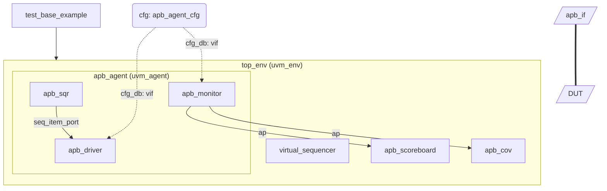

# Testbench Architecture-Diagram Specification

> 本文件是 **UVM Testbench Architecture-Diagram 绘制 Skill** 的输出格式规范。Agent 在生成任何 Mermaid 图时，**必须严格遵循本规范**，以保证输出的一致性、可渲染性和可 diff 性

---

## 1. 目标与适用范围

- **输入**：UVM Testbench 源码（SystemVerilog）或仿真 Run Log（如 `uvm_top.print_topology()` 输出、`uvm_report` 层级打印）
- **输出**：一张（或多张）符合本规范的 **Mermaid `flowchart`** 架构图，描述 TB 的组件层级、TLM 连接、Virtual Interface 绑定和 config_db 依赖关系
- **优先级**：源码与 log 信息冲突时，以 **log 中实际例化的层级** 为准；源码中存在但 log 中未例化的组件不绘制（除非用户显式要求“设计视图”）

## 2. 图类型与全局规则

### 2.1 图类型

- 架构图：强制使用 `block` 类型
  - 子组件框图强制横向排布，避免竖向长条
- 状态机状态图：强制使用 `stateDiagram` 类型
- 类关系图：强制使用 `classDiagram` 类型

### 2.2 全局硬性规则

| 规则 | 说明 |
| --- | --- |
| R1 单图上限 | 单张图节点数 ≤ 40；超出时按 `uvm_env` 或 `uvm_agent` 边界拆分为多张图（主图 + 各 env 详情图），并用同一命名前缀关联 |
| R2 ID 命名 | 节点/子图 ID 使用 `蛇形命名法`，由层级路径推导：`<agent>_<driver>`、`<env>_<scoreboard>` 等，全图唯一且稳定（同一组件多次生成必须得到同一 ID） |
| R3 标签内容 | 显示标签使用 `["..."]`，内容为组件 **实例名**（path 的最后一段）；括号、引号等特殊字符必须转义或移除 |
| R4 禁止裸文本 | 所有节点必须显式指定形状语法，禁止 `A-->B` 中出现无形状声明的节点 |
| R5 语法校验 | 输出前自检：括号配对、引号配对、subgraph/end 配对、箭头语法合法 |
| R6 注释 | 图中不写 Mermaid 注释（`%%`），元信息放在图外的 Markdown 正文中 |

## 3. UVM 概念 → Mermaid 元素映射表

这是本规范的核心。**映射关系是强制性的，不允许 agent 自行发挥。**

| UVM 概念 | Mermaid 元素 | 形状/语法 | 说明 |
| --- | --- | --- | --- |
| `uvm_test` | 顶层节点 | `test["testcase_name"]` | 图的根节点，每个 test 一张图，test 可以根据继承关系嵌套 |
| `uvm_env` | 子图 | `subgraph env_xxx [...] end` | 常嵌套于 base test 內 |
| `uvm_agent` | 子图 | `subgraph agent_xxx [...] end` | 嵌套于 env 子图内 |
| `uvm_driver` | 节点 | `drv["uvm_driver"]` | 矩形 |
| `uvm_monitor` | 节点 | `mon["uvm_monitor"]` | 矩形 |
| `uvm_sequencer` | 节点 | `sqr["uvm_sequencer"]` | 矩形 |
| `uvm_scoreboard` | 节点 | `scb["uvm_scoreboard"]` | 矩形 |
| `uvm_coverage`（覆盖收集组件） | 节点 | `cov["uvm_coverage"]` | 矩形 |
| `uvm_virtual_sequencer` | 节点 | `vsqr["uvm_virtual_sequencer"]` | 矩形，置于 env 子图外层 |
| `uvm_config_db` 相关 config object | 节点 | `cfg_xxx("cfg: agent_config")` | 圆角 `()`，表示纯 object，非 component |
| `uvm_sequence / uvm_sequence_item` | 节点（可选） | `seq{{"seq: xxx_seq"}}` | 六边形 `{{}}`；仅当用户要求“含序列视图”或 log 中有明确启动记录时绘制 |
| `virtual interface` / interface | 节点 | `vif_xxx[/"vip_if"/]` | 平行四边形 `[/.../]`，表示硬件连接点 |
| `DUT` | 节点 | `dut[/"DUT"/]` | 平行四边形 + 独立样式（硬件侧） |
| RAL model (`uvm_reg_block`) | 节点（可选） | `ral[[/"reg_block"/]]` | 双边平行四边形；有寄存器模型时绘制 |

### 3.1 隐含组件的处理（log 分析场景）

Run log 的 topology 打印**通常不显示 driver/monitor/sequencer**（它们作为 agent 的 children 打印时可能被省略或折叠）。处理规则：

1. 若 log 打印了完整 children 列表 → 全部绘制。
2. 若 log 只打印到 agent 级 → 根据源码中 `build_phase` 的 `type_id::create` 推断 agent 内部构成；源码不可得时，按该 agent 的**类型惯例**绘制标准三件套，并在图外 Markdown 中注明 `# 推断：agent 内部结构基于类型惯例，未在 log 中确认`。
3. **禁止虚构不存在证据的组件**（如凭空添加 scoreboard）。

## 4. 连接（Edge）规范

### 4.1 TLM 连接 —— 实线箭头

- 语法：`A -->|"port 类型"| B`
- **方向语义**：箭头从 **port 声明方（producer/exporter）** 指向 **被连接的对方**，即与 `connect_phase` 中 `a.port.connect(b.export)` 的 `a → b` 一致。
- 端口类型写入边标签，标签使用简写：
| UVM 端口 | 标签写法 |
|---|---|
| `uvm_analysis_port` / `uvm_analysis_export` | `ap` |
| `uvm_seq_item_port` | `seq_item_port` |
| `uvm_analysis_fifo`（经 FIFO 中转） | `ap → fifo → ...` 拆为两条边，FIFO 节点用 `(["fifo"])` 圆柱形 |
| `uvm_tlm_analysis_fifo` 同上 | 同上 |
| `uvm_blocking_get_port` 等 get/put 族 | `get_port` / `put_port` |

示例：

```mermaid
mon -->|ap| scb
sqr -->|seq_item_port| drv
mon -->|ap| fifo1(["tlm_analysis_fifo"])
fifo1 -->|get_port| scb
```

### 4.2 config_db 依赖 —— 虚线箭头（★核心约束）

- 语法：`setter -.->|"cfg_db: field_name"| getter`
- **方向**：从 `set()` 调用所在的组件，指向 `get()` 生效的组件（通常为最终持有该配置/接口的叶子组件）。
- **标签**：`cfg_db:` 前缀 + 被传递的最具体字段名或 `vif`。
- **同层多字段**：多条 config_db 依赖合并为一条边，标签用 `<br/>` 分隔，最多 3 条，超出则写 `cfg_db: 5 fields`。
- **vif 传递**：`config_db#(virtual xxx_if)::set` 且 getter 为 driver/monitor 时，绘制 `agent 的 vif 节点 -.-> driver` 与 `vif 节点 -.-> monitor` 两条虚线，标签 `cfg_db: vif`。
- **log 分析场景**：log 通常无法直接看到 config_db，需结合 `uvm_config_db` 的 warning/error 打印或源码推断；无法确认时不画，在图外注明 `# config_db 依赖未确认，未绘制`。

### 4.3 Virtual Sequence → Virtual Sequencer —— 点线箭头

- 语法：`seq_vs{{"vseq"}} -.->|"start on"| vsqr`
- 仅在“含序列视图”模式下绘制。

### 4.4 与 DUT 的连接

- interface 节点与 DUT 之间使用**粗实线**：`vif_xxx === dut`
- 若 interface 很多（>5 条），合并为一条边并在标签中列数量：`vif_grp[/5 interfaces/] === dut`。

### 4.5 禁止的边画法

- 禁止双向箭头 `<-->`（UVM 连接总有明确方向）。
- 禁止无标签的实线（无法区分 TLM 与其他连接）；无标签虚线允许用于 subgraph 之间的 “包含/聚合” 关系。
- 禁止跨 subgraph 的隐式连线绕过父级（agent 内部组件到 env 级 scoreboard 的 `ap` 连接**允许**直接跨层连线，这是 UVM 常态）。

## 5. 层级与布局规则

1. **subgraph 嵌套深度 ≤ 3**：`env > agent > (组件节点)`。若出现 env 套 env，内层 env 提升为平级子图，用虚线边标注 `contains`。
2. subgraph 标题使用实例名 + 类型：`subgraph agent_xxx ["apb_agent (uvm_agent)"]`。
3. agent 子图内固定顺序：`sequencer → driver → monitor`（LR 方向下从左到右）。
4. virtual sequencer 与 scoreboard 不放入任何 agent 子图，放在其所属 env 子图的直接层级。
5. config object 节点统一放在对应 agent/env 子图的**外侧上方**，保证虚线箭头方向向下，不与 TLM 实线交叉。
6. DUT 固定放图的最底部（TB 在上、DUT 在下）。

## 6. 样式规范（classDef）

每张图末尾必须附加以下统一样式定义（可按需删减未使用的 class，但**不得修改定义**）：

```mermaid
flowchart TB
    %% ... 节点与连线 ...
    classDef testCls fill:#4A90D9,stroke:#2C5F8A,color:#fff
    classDef compCls fill:#E8F1FA,stroke:#4A90D9,color:#1a1a1a
    classDef agentCls fill:#FDF6E3,stroke:#B58900
    classDef envCls fill:#F0F7F0,stroke:#5F9E5F
    classDef cfgCls fill:#F3E5F5,stroke:#8E44AD,color:#1a1a1a
    classDef ifCls fill:#FFF8E1,stroke:#F57F17
    classDef dutCls fill:#37474F,stroke:#263238,color:#fff
    classDef fifoCls fill:#FFF,stroke:#999
    class test testCls
    class drv,mon,sqr,scb,cov,vsqr compCls
    class vif_apb,vif_axi ifCls
    class cfg_apb cfgCls
    class dut dutCls
```

- 颜色语义固定：**蓝 = component，黄 = agent 容器，绿 = env 容器，紫 = config object，深灰 = DUT**。
- 不允许使用 `style` 逐节点内联样式，必须走 `classDef` + `class`。

## 7. 完整示例（标准输出样板）



图外必须附带的结构化摘要（Markdown 表格，字段固定）：

| 层级路径 | 类型 | 绘制依据 |
| --- | --- | --- |
| `uvm_test_top.env_top` | uvm_env | log: print_topology |
| `...agent_apb.apb_driver` | uvm_driver | log: print_topology |
| `...agent_apb` config | config_db set | 源码: top.sv:88 |

## 8. 输出前自检清单（Agent 必须逐项执行）

- [ ] 图类型为 `flowchart TB`，agent 子图内有 `direction LR`
- [ ] 所有节点有显式形状；ID 唯一、蛇形、与层级路径对应
- [ ] 组件映射与第 3 节表格完全一致（test=矩形根节点、cfg=圆角、if/DUT=平行四边形、seq=六边形）
- [ ] TLM 边：实线 + 端口标签；config_db 边：虚线 + `cfg_db:` 前缀；DUT 连接：粗实线
- [ ] 无 `<-->`、无无标签实线、无内联 `style`
- [ ] classDef 与第 6 节定义一致
- [ ] 节点数 ≤ 40，subgraph 深度 ≤ 3
- [ ] 图外附层级摘要表，推断项均已标注
- [ ] 已在本地（心智上）渲染一次：括号、引号、`end` 均配对

## 9. 失败与降级策略

| 情况 | 处理 |
| --- | --- |
| 无法解析出任何组件层级 | 不输出 Mermaid，向用户说明缺失的输入（期望 topology 打印或源码片段） |
| Mermaid 渲染报错风险高（节点名含 `::` 等） | ID 层面替换为 `_`，标签保留原名 |
| 组件角色无法判定（自定义基类） | 归类为 `compCls` 矩形，标签写 `<基类名>`，摘要表 `类型` 列注明 `unclassified` |
| 多 test 的 run log | 每个 test 各输出一张图，标题为 `### Test: <test_name>` |

*规范版本：v1.0 · 适用于 UVM-1.2 / IEEE 1800.2 testbench*
